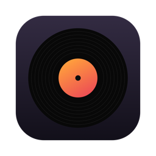
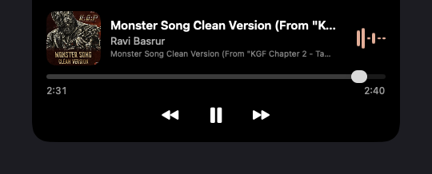
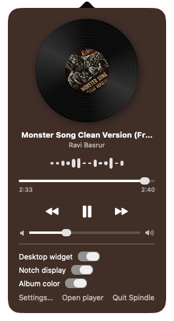
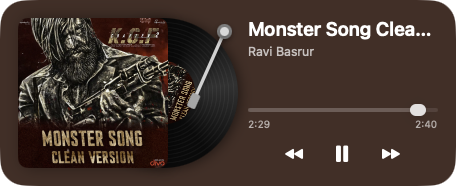
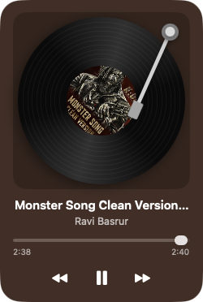
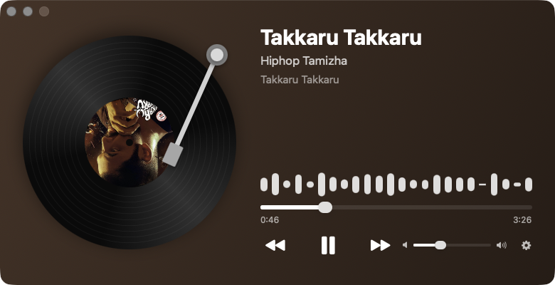
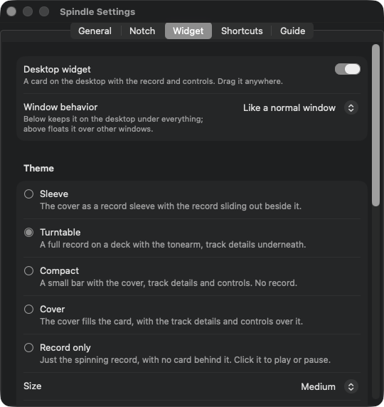

<div align="center">



# Spindle

**A record player for your Mac's menu bar.**
Whatever you're playing in Spotify, Apple Music or a browser, spinning on a vinyl in the notch, the menu bar and on your desktop.



</div>

---

## Features

**Notch pill.** A pill around the camera housing (or the top of the menu bar on displays without one) shows the cover and a set of bars in the cover's own colour. Hover it and it drops open into a small player with the seek bar and controls. It comes in solid black or Liquid Glass, light or dark, and hides itself while an app is full screen.

**Menu bar player.** Click the disc for a spinning record with the cover as its label, track details, seek bar, transport controls and volume.

**Desktop widget.** Five themes (Sleeve, Turntable, Compact, Cover, Record only), four sizes, a tonearm that swings onto the record while music plays, and backgrounds in the album colour, a blurred cover, your own colour or image, Liquid Glass, or nothing at all. Keep it below your windows, above them, or in between.

**Main player window.** The record at full size with everything about the track beside it. Open Spindle again from Finder or Spotlight to bring it up.

**And also**
- Follows Spotify, Apple Music, and music sites in Safari, Chrome, Brave, Edge and Arc
- Four record pressings (classic black, album colour, picture disc, gold) and three tonearms
- Global keyboard shortcuts you record yourself
- Sleep timer, time-remaining display, cover art as your desktop picture
- Launch at login, optional Dock icon with the cover as the icon
- 18 languages, with a right-to-left layout for Arabic

## Screenshots

| Menu bar player | Desktop widget |
|:---:|:---:|
|  | <br><br> |

| Main window |
|:---:|
|  |

| Settings |
|:---:|
|  |

## Requirements

- macOS 14 or later. Liquid Glass styles need macOS 26.
- Swift 5.9 or later. The Xcode Command Line Tools are enough; full Xcode is not needed.

## Build and run

```bash
./Scripts/build-app.sh
open build/Spindle.app
```

The script builds a release binary with Swift Package Manager, assembles `build/Spindle.app` with its icon and translations, and signs it ad hoc for your own Mac.

## First run

1. **Allow Spindle to control your player.** The first time Spotify or Music is open, macOS asks whether Spindle may control it. Choose **Allow**. If you said no, turn it back on in *System Settings → Privacy & Security → Automation*.
2. **Optional: music in a browser.** Turn on *Music in browsers* in Spindle's settings, then in each browser you use:
   - **Safari:** *Settings → Advanced →* tick *Show features for web developers*, then in the new *Developer* tab tick *Allow JavaScript from Apple Events*.
   - **Chrome, Brave, Edge, Arc:** *View → Developer → Allow JavaScript from Apple Events*.

   Spindle only reads tabs on music sites (YouTube, YouTube Music, Spotify, Apple Music, Amazon Music, Tidal, SoundCloud, Deezer, Pandora, Qobuz, Mixcloud and Yandex Music), and its settings tell you which browser still needs the switch.

## How it works

Spindle has no access to the audio itself. It asks each player what is playing:

- **Spotify and Apple Music** through AppleScript, refreshed once a second and straight away when either app announces a track change.
- **Browsers** by running a short script in the music tab that reads the page's media session and `<video>`/`<audio>` element. These scripts run in a separate process so a browser that is slow to answer never holds up the rest of the app.

The bars are decorative: their levels are random, not measured from the sound, so Spindle needs no microphone or screen-recording permission.

## Project layout

```
Sources/Spindle/
  App.swift              app delegate: menu bar item, windows, notch pills, shortcuts
  PlayerBridge.swift     Spotify and Apple Music over AppleScript
  BrowserBridge.swift    music tabs in Safari and Chrome-family browsers
  MusicViewModel.swift   current track, polling, artwork and its colours
  PlayerViews.swift      popover, notch pill, shared controls
  WidgetView.swift       desktop widget themes and the tonearm
  PlayerWindowView.swift main player window
  VinylView.swift        the spinning record
  SettingsView.swift     settings window
  Settings.swift         preferences
  HotKeys.swift          global shortcuts
  Wallpaper.swift        cover art as desktop picture
Localization/            one text file per language, line-for-line with keys.txt
Scripts/                 build-app.sh, make-strings.py, make-icon.swift
```

To add or fix a translation, edit the matching line in `Localization/<language>.txt`; the build turns these into `.lproj` folders.

## Known limitations

- **Apple Music:** works for tracks in your library; info and artwork for streamed Apple Music tracks are untested.
- **Browser next/previous** press the site's own buttons, so they work best on YouTube, YouTube Music, Spotify and SoundCloud.
- **Translations** were written without a native-speaker review.
- **Not notarised:** the build is signed ad hoc, so on another Mac it has to be opened with right-click → *Open*.
